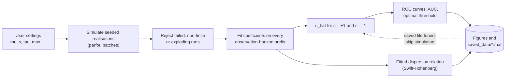

<div align="center">

# Stability Analysis of Pitchfork and Swift–Hohenberg Models

**MATLAB code for simulating stochastic pitchfork and Swift–Hohenberg systems, estimating model coefficients from noisy (spatio)temporal data, and testing whether the fitted cubic coefficient can tell supercritical from subcritical bifurcations.**


[Paper](#companion-paper) ·
[Quick start](#quick-start) ·
[Paper figures](#recreating-the-paper-figures) ·
[Workflows](#workflows) ·
[Outputs](#saved-results-and-figures) ·
[Troubleshooting](#troubleshooting) ·
[Citation](#citation)

</div>

---

## Companion paper

This repository contains the code behind

> **Early warning of critical transitions: Distinguishing supercritical and subcritical bifurcations from noisy observations**
> Paul A. Sanders, Christian Kuehn, Bastian Hilder, Robbin Bastiaansen
> *Manuscript in preparation (draft of October 2026). Link and DOI will be added on publication.*

The paper extends regression-based stability analysis (fitting the linear terms of a model to noisy fluctuations around an equilibrium) with a **cubic term**. The fitted cubic coefficient $\hat{s}$ indicates the type of bifurcation: $\hat{s}<0$ suggests a *supercritical* bifurcation and $\hat{s}>0$ a *subcritical* one. The code tests this idea on two models where the truth is known, and quantifies it with ROC curves and AUC values:

| Question studied | Where |
| --- | --- |
| How does classification depend on the distance to the bifurcation $\mu$ and on the observation horizon $\tau_{\max}$? | pitchfork and Swift–Hohenberg ($\tau_{\max}$ sweep) |
| Does observing the full spatial field allow shorter observation horizons? | Swift–Hohenberg |
| How does the strength of the spatial operator $\gamma$ (how many spatial modes contribute) affect classification? | Swift–Hohenberg ($\gamma$ sweep) |
| Does the fitted dispersion relation still recover the true dominant wavenumber and growth rate once the cubic term is included? | Swift–Hohenberg |

The complete output folders of the paper runs (processed data and all figures) are included, so the figures can be inspected or recreated without re-running the simulations, see [Recreating the paper figures](#recreating-the-paper-figures).

Section and parameter numbers below refer to the October 2026 draft and may change as the paper is revised.

---

## Contents

1. [Overview](#overview)
2. [Repository structure](#repository-structure)
3. [Requirements](#requirements)
4. [Quick start](#quick-start)
5. [Models and method](#models-and-method)
6. [Workflows](#workflows)
   - [Pitchfork](#pitchfork-workflow)
   - [Swift–Hohenberg, observation-horizon sweep](#swifthohenberg-observation-horizon-sweep)
   - [Swift–Hohenberg, gamma sweep](#swifthohenberg-gamma-sweep)
7. [Function reference](#function-reference)
8. [Recreating the paper figures](#recreating-the-paper-figures)
9. [Settings used in the paper](#settings-used-in-the-paper)
10. [Saved results and figures](#saved-results-and-figures)
11. [Numerical and methodological notes](#numerical-and-methodological-notes)
12. [Reproducibility](#reproducibility)
13. [Troubleshooting](#troubleshooting)
14. [Citation](#citation)
15. [Contact](#contact)

---

## Overview

The code supports two related model systems and three experiments:

1. **Pitchfork model**
   - Simulate stochastic pitchfork trajectories for a sweep of negative values of `mu` and both signs of the cubic coefficient `s`.
   - Estimate the model coefficients at several observation horizons.
   - Use the estimated cubic coefficient, `s_hat`, as a classification score.
   - Evaluate classification performance with ROC curves and AUC values, and find the optimal classification threshold as a function of `mu`.

2. **Swift–Hohenberg model**
   - Simulate stochastic spatial patterns on a periodic domain with a Fourier/FFT solver.
   - Estimate linear and cubic coefficients from the simulated spatiotemporal data.
   - Estimate the most unstable wavenumber and its growth rate.
   - Evaluate classification performance using the estimated cubic coefficient.
   - Compare estimated and theoretical dispersion relations.
   - Two experiments: a sweep over the **observation horizon** $\tau_{\max}$ at fixed $\gamma$, and a sweep over the **spatial parameter** $\gamma$ at fixed $\tau_{\max}$.

Each *combined* script performs repeated simulations, analyses the valid realisations, saves the processed results and generates the figures.



---

## Repository structure

The repository is organised into separate simulation, analysis and combined-workflow folders for each model:

```text
.
├── Pitchfork/
│   ├── Simulation/
│   │   └── simulate_pitchfork.m                  # Euler–Maruyama pitchfork simulator
│   ├── Analysis/
│   │   └── analyze_pitchfork.m                   # regression for [mu_hat; s_hat]
│   ├── Combine/
│   │   └── Pitchfork_loops_results.m             # simulate + analyse + ROC/AUC + figures
│   └── Pitchfork_ROC_nr=100_tmin=1_tmax=5e+03_nt=12_dt=0.01/   # output of the paper run
│
└── Swift_Hohenberg/
    ├── Simulation/
    │   └── simulate_scaled_SH_Fourier.m          # periodic FFT-based SH simulator
    ├── Analysis/
    │   └── analyze_SH_scaled.m                   # coefficients, dispersion relation, k_max
    ├── Combine/
    │   ├── SH_loops_results.m                    # tau_max sweep at fixed gamma
    │   └── SH_ROC_scaled_gamma_FFT_updated_v2.m  # gamma sweep
    ├── SH_ROC_scaled_FFT_mu_s_real=100_dx=0.2pi_dt=0.00025/           # output of the paper run (tau_max sweep)
    └── SH_ROC_scaled_FFT_mu_s_real=100_dx=0.2pi_dt=5e-05_gamma/     # output of the paper run (gamma sweep)
```

| Folder | Contents |
| --- | --- |
| `Simulation/` | Function that generates one stochastic realisation. |
| `Analysis/` | Function that estimates coefficients (and, for Swift–Hohenberg, dispersion-related quantities) from one realisation. |
| `Combine/` | Scripts that combine simulation, analysis, saving and plotting. **These are the entry points.** |
| `Pitchfork_ROC_...`, `SH_ROC_...` | Complete output folders (processed data and figures) of the runs behind the paper, see [Recreating the paper figures](#recreating-the-paper-figures). |

> [!NOTE]
> The two folders of each model only need to be on the MATLAB path. The scripts call the functions by name, so the files can be moved between folders as long as the function names stay the same as the file names.

---

## Requirements

| Requirement | Used for |
| --- | --- |
| **MATLAB R2020a or newer** (developed with R2025b) | scripts, local functions, string scalars such as `"White"`, `exportgraphics`, `tiledlayout`, `orderedcolors` |
| **Parallel Computing Toolbox** | `parfor` simulation batches |
| **Statistics and Machine Learning Toolbox** | `perfcurve` (ROC/AUC), `ksdensity` (density panels), `prctile` (dispersion summaries) |
| MATLAB graphics | `exportgraphics`, `savefig`, tiled layouts, figure annotations |

The repository needs no external data files. The combined scripts generate the stochastic data when no compatible saved result is found. The processed output of the runs behind the paper is included, see [Recreating the paper figures](#recreating-the-paper-figures).

---

## Quick start

**1. Clone the repository**

```bash
git clone https://github.com/<your-username>/<your-repository>.git
cd <your-repository>
```

Replace the URL with the URL of this repository.

**2. Add the code to the MATLAB path and choose an output folder**

The combined scripts write their results to the **current folder**, so work in a separate folder:

```matlab
repoRoot = pwd;                  % the cloned repository
addpath(genpath(repoRoot));      % add all model folders
% savepath;                      % optional: keep the path for future sessions

mkdir('results'); cd('results'); % outputs are created here
```

To add only one model, use `addpath(genpath(fullfile(repoRoot,'Pitchfork')))` or `addpath(genpath(fullfile(repoRoot,'Swift_Hohenberg')))`.

**3. Run a combined script by name**

```matlab
Pitchfork_loops_results                  % pitchfork:   mu and tau_max sweep
SH_loops_results                         % Swift–Hohenberg: tau_max sweep at fixed gamma
SH_ROC_scaled_gamma_FFT_updated_v2       % Swift–Hohenberg: gamma sweep
```

> [!TIP]
> Run the scripts **by name**, not with `run('Pitchfork/Combine/Pitchfork_loops_results.m')`. `run` with a path temporarily changes into the script's folder, so the output folders would end up next to the code instead of in `results/`.

> [!WARNING]
> Every combined script starts with `clearvars; clc;`, so it clears the variables in your MATLAB workspace.

> [!TIP]
> Only want the figures of the paper? You do not need to simulate anything: the output folders of the paper runs are included, see [Recreating the paper figures](#recreating-the-paper-figures).

**4. Test with small settings first**

All settings are in the *USER SETTINGS* section at the top of each script. A full run uses 100 realisations per parameter combination; before running the paper settings, try something small such as:

<details>
<summary><b>Small test settings (click to expand)</b></summary>

Pitchfork (`Pitchfork_loops_results.m`):

```matlab
n_realizations   = 10;
mu_values        = -logspace(-1,2,6);
tmax_values      = [1 2 5 10 20];
rerunSimulations = true;
```

Swift–Hohenberg, $\tau_{\max}$ sweep (`SH_loops_results.m`):

```matlab
n_realizations   = 10;
mu_values        = -logspace(-1,2,6);
tmax_values      = [0.5 1 2];
rerunSimulations = true;
```

Swift–Hohenberg, $\gamma$ sweep (`SH_ROC_scaled_gamma_FFT_updated_v2.m`):

```matlab
n_realizations   = 10;
mu_values        = -logspace(-1,2,6);
gamma_values     = [0.1 1 10];
rerunSimulations = true;
```

`n_realizations` is part of the output-folder name, so a test with different `n_realizations` never overwrites a full run. Settings that are *not* part of the folder name (for example `mu_values`) are only picked up when `rerunSimulations = true`, see [Saved results and figures](#saved-results-and-figures).

</details>

Other things to check before a production run: the time step `dt_target` (only larger when numerically appropriate), memory use, and the number of parallel workers.

---

## Models and method

### Pitchfork normal form

The stochastic pitchfork normal form with additive noise is rescaled to

$$
\mathrm{d}q = \left(\mu\, q + s\, q^{3}\right)\mathrm{d}\tau + \mathrm{d}W_\tau ,
\qquad s\in\{-1,+1\},\quad \mu<0 .
$$

Here $\mu$ is the scaled distance to the bifurcation at $\mu=0$ (relative to noise and nonlinearity), and $s=-1$ is the **supercritical**, $s=+1$ the **subcritical** case. The code keeps a noise amplitude `sigma` (default 1, which is the scaled model above). For $s=+1$, trajectories can leave the local region around $q=0$ (noise-induced tipping); such trajectories are excluded, see [Numerical and methodological notes](#numerical-and-methodological-notes).

### Swift–Hohenberg equation

On a periodic one-dimensional domain the reduced stochastic Swift–Hohenberg equation is

$$
\mathrm{d}q = \left[\mu\, q - \gamma\,(1+\partial_X^2)^2 q + s\, q^{3}\right]\mathrm{d}\tau + \mathrm{d}W_\tau ,
$$

with linear dispersion relation $\lambda(k)=\mu-\gamma(1-k^2)^2$. Its maximum is $\lambda=\mu$ at $k=1$, so $\mu$ controls stability while $\gamma$ controls how strongly the modes around $k=1$ are damped (large $\gamma$: narrow band of weakly damped modes; small $\gamma$: broad band). Expanding the operator gives the coefficients the regression should recover:

$$
a_0=\mu-\gamma,\qquad a_2=-2\gamma,\qquad a_4=-\gamma,\qquad s .
$$

### Regression and classification

For every realisation and observation horizon the code

1. computes the time derivative by a **forward difference**, $\dfrac{q_{i+1}-q_i}{\tau_{i+1}-\tau_i}$ (consistent with Euler–Maruyama);
2. computes spatial derivatives **spectrally** with the FFT (Swift–Hohenberg only);
3. regresses the time derivative on a small library of candidate terms by least squares:

| Model | Library | Fitted vector $\hat\theta$ | ROC score |
| --- | --- | --- | --- |
| Pitchfork | $q,\ q^3$ | $[\hat\mu;\ \hat s]$ | `theta(2)` (`kc_shat = 2`) |
| Swift–Hohenberg | $q,\ q_{XX},\ q_{XXXX},\ q^3$ | $[\hat a_0;\ \hat a_2;\ \hat a_4;\ \hat s]$ | `theta(4)` (`kc_shat = 4`) |

4. (Swift–Hohenberg) forms the fitted dispersion relation $\hat\lambda(k)=\hat a_0-\hat a_2k^2+\hat a_4k^4$ and extracts its dominant wavenumber $\hat k_*$ and growth rate $\hat\lambda_*$;
5. classifies with $\hat s$: **`s > 0` is the positive class (subcritical), `s < 0` the negative class (supercritical)**. ROC curves are built by varying the threshold on $\hat s$ and the AUC summarises separability (0.5: chance level, 1: perfect separation).

---

## Workflows

All three combined scripts follow the same pattern: *settings → (load saved data) → simulate in `parfor` batches with deterministic seeds → reject invalid runs → fit at every horizon → AUC → save → figures.*

### Pitchfork workflow

**Script:** `Pitchfork/Combine/Pitchfork_loops_results.m`
**Functions:** [`simulate_pitchfork`](#function-reference), [`analyze_pitchfork`](#function-reference)

What it does:

1. Defines the `mu`, `s`, noise, time-step and realisation settings.
2. Creates simulation batches using deterministic seed IDs.
3. Runs independent seeds in parallel with `parfor`.
4. Rejects failed, non-finite or explosively large trajectories.
5. Estimates `theta` at every requested observation horizon (prefixes of each trajectory).
6. Adaptively reduces the active maximum horizon if fewer than 10 % of the requested realisations remain valid at the longest horizon.
7. Computes AUC values using the selected `s_hat` component.
8. Produces AUC, density, ROC and optimal-threshold figures.
9. Saves the processed results in a settings-specific `saved_data` folder.

Default settings (these match the pitchfork experiment in the paper):

```matlab
noiseType             = "White";
InitialScale          = 0;
sigma                 = 1;
mu_values             = -logspace(-1,2,50);
s_values              = [1, -1];
n_realizations        = 100;
u_explosion_threshold = 1e10;
tmax_values           = [1,2,5,10,20,50,100,200,500,1000,2000,5000];   % at most 12
dt_target             = 0.01;
kc_shat               = 2;     % component of theta used as the ROC score (s_hat)
nThetaComp            = 2;
rerunSimulations      = false;
```

### Swift–Hohenberg observation-horizon sweep

**Script:** `Swift_Hohenberg/Combine/SH_loops_results.m`
**Functions:** [`simulate_scaled_SH_Fourier`](#function-reference), [`analyze_SH_scaled`](#function-reference)

Sweeps $\mu$ and $\tau_{\max}$ at a **fixed** `gamma_value`. What it does:

1. Defines the parameter sweep, periodic spatial grid, time step, noise settings and observation horizons.
2. Simulates independent stochastic realisations with the periodic FFT solver.
3. Analyses each trajectory prefix at the requested observation horizons.
4. Rejects invalid, non-finite or explosively large fields.
5. Stores the estimated theta coefficients, dominant wavenumbers, growth rates and seed IDs.
6. Adaptively reduces the active observation horizon when too few realisations reach the longest horizon (it stops drawing seeds after `maxBatches = 20` batches and keeps what it has).
7. Computes AUC values using the selected cubic-coefficient estimate.
8. Generates AUC, density, ROC and dispersion-summary figures.
9. Saves the processed results in a settings-specific `saved_data` folder.

Default settings:

```matlab
noiseType             = "White";
correlation_length    = 0;
InitialScale          = 0;
NoiseScale            = 1;
mu_values             = -logspace(-1,2,20);
gamma_value           = 1;
s_values              = [1, -1];
n_realizations        = 100;
u_explosion_threshold = 1e10;
tmax_values           = [0.1, 0.2, 0.5, 1, 2, 5, 10, 20];
L_values              = 20*pi;
dx_target             = 0.2*pi;      % Nx = L/dx_target = 100 points
dt_target             = 2.5e-4;
kc_shat               = 4;
nThetaComp            = 4;
rerunSimulations      = false;
```

### Swift–Hohenberg gamma sweep

**Script:** `Swift_Hohenberg/Combine/SH_ROC_scaled_gamma_FFT_updated_v2.m`
**Functions:** [`simulate_scaled_SH_Fourier`](#function-reference), [`analyze_SH_scaled`](#function-reference)

The $\gamma$-sweep counterpart of `SH_loops_results.m`: it varies the spatial parameter $\gamma$ at fixed observation horizon(s). For every $(\mu,\gamma,s)$ it collects `n_realizations` **complete** runs (all fitted quantities finite at every requested horizon); if fewer than 10 % of the first batch are usable, that combination is skipped and left empty. It produces one set of ROC and dispersion figures per $\gamma$, and an AUC-versus-$\mu$ figure with one line per $\gamma$.

Default settings:

```matlab
noiseType             = "White";
correlation_length    = 0;
InitialScale          = 0;
NoiseScale            = 1;
mu_values             = -logspace(-1,2,20);
gamma_values          = [0,0.1,0.2,0.5,1,2,5,10,20,50];
s_values              = [1, -1];
n_realizations        = 100;
u_explosion_threshold = 1e10;
L_values              = 20*pi;
dx_target             = 0.2*pi;
dt_target             = 5e-5;        % smaller than in SH_loops_results.m for stability at large gamma
tmax_values           = 2;           % observation horizon tau_max (integer multiple of dt_target)
kc_shat               = 4;
nThetaComp            = 4;
rerunSimulations      = false;
```

---

## Function reference

<details>
<summary><b>Click to expand the four simulation and analysis functions</b></summary>

### `simulate_pitchfork`

Generates one stochastic pitchfork trajectory (Euler–Maruyama, scaled time $\tau$).

```matlab
[tau, q] = simulate_pitchfork(mu, s, tmax, tsteps, noiseType, NoiseScale, InitialScale)
```

| Input | Description |
| --- | --- |
| `mu` | Linear coefficient. The combined script uses negative values generated by `-logspace(-1,2,50)`. |
| `s` | Cubic coefficient / sign: `+1` subcritical, `-1` supercritical. The workflow uses `s_values = [1, -1]`. |
| `tmax` | Final scaled time $\tau_{\max}$. |
| `tsteps` | Number of stored time points, including $\tau=0$ and $\tau=\tau_{\max}$. The combined script computes it as `round(tmax/dt_target) + 1`. |
| `noiseType` | `'White'` (Gaussian increments), `'Uniform'` (unit-variance uniform increments) or `'None'` (deterministic). Case-insensitive; the example uses `"White"`. |
| `NoiseScale` | Noise amplitude (`sigma` in the combined script). |
| `InitialScale` | Standard deviation of the random initial condition, $q(0)=$ `InitialScale*randn`. The example uses `0` (start at $q=0$). |

| Output | Description |
| --- | --- |
| `tau` | `tsteps`-by-1 time vector. |
| `q` | `tsteps`-by-1 simulated trajectory. |

Random numbers come from MATLAB's global stream, so seed it in the caller (the combined scripts use `rng(seed,'combRecursive')`).

### `analyze_pitchfork`

Estimates the pitchfork coefficients from a trajectory (or a trajectory prefix).

```matlab
[theta, R, rmse] = analyze_pitchfork(q_time, tau)
```

| Output | Description |
| --- | --- |
| `theta` | `[mu_hat; s_hat]`. The combined script stores both components and uses the second one as the ROC score (`kc_shat = 2`). |
| `R` | Residuals of the regression (not used by the combined script, which calls the function with `~` for `R` and `rmse`). |
| `rmse` | Root-mean-square of the residuals. |

The least-squares problem is solved with a cascade of solvers: QR decomposition, then the normal equations, then the pseudo-inverse (with a warning) if the design matrix is nearly singular.

### `simulate_scaled_SH_Fourier`

Generates stochastic Swift–Hohenberg data on a periodic domain with an FFT-based solver (Euler–Maruyama in time; linear part advanced in Fourier space, cubic term in physical space).

```matlab
[tau, X, q] = simulate_scaled_SH_Fourier(mu, s, gamma, tmax, tsteps, L, xsteps, ...
                  noiseType, correlation_length, NoiseScale, InitialScale)
```

| Input | Description |
| --- | --- |
| `mu` | Linear coefficient. The example sweep uses negative values generated by `-logspace(-1,2,20)`. |
| `s` | Cubic coefficient / sign. The workflow uses `s_values = [1, -1]`. |
| `gamma` | Spatial-operator strength (`gamma_value` in `SH_loops_results.m`, an entry of `gamma_values` in the $\gamma$ sweep). The example uses `1`. |
| `tmax` | Final scaled time $\tau_{\max}$. |
| `tsteps` | Number of stored time points, computed from `tmax` and `dt_target`. |
| `L` | Length of the periodic domain. The example uses `20*pi`. |
| `xsteps` | Number of unique periodic grid points $N_x$, computed as `L/dx_target`; the example gives `100`. |
| `noiseType` | `'White'` (space–time white noise), `'Correlated'` (white noise smoothed by a Gaussian filter, needs `correlation_length > 0`), `'Uniform'` or `'None'`. |
| `correlation_length` | Width of the Gaussian smoothing filter; only used for `'Correlated'`. The example uses `0`. |
| `NoiseScale` | Noise-strength scaling factor. The example uses `1`. |
| `InitialScale` | Standard deviation of the random initial condition. The example uses `0`. |

| Output | Description |
| --- | --- |
| `tau` | `tsteps`-by-1 time vector. |
| `X` | 1-by-$N_x$ grid on the periodic domain: $X_j=j\,\Delta X$, $j=0,\dots,N_x-1$, $\Delta X=L/N_x$. |
| `q` | `tsteps`-by-$N_x$ spatiotemporal field (row *i* is the field at time `tau(i)`). |

The periodic grid uses unique points on $[0,L)$, so the endpoint $X=L$ is not duplicated. The combined scripts check that `L` is an integer multiple of `dx_target`. The explicit Euler scheme is stable only if `dt * max(-lambda_k) < 2` over all resolved Fourier modes. The function raises an error if this is violated and a warning above 1.5.

### `analyze_SH_scaled`

Estimates Swift–Hohenberg coefficients and dispersion-related quantities from a spatiotemporal field.

```matlab
[theta, k_max, max_eigenvalue] = analyze_SH_scaled(q, tau, X)
```

| Output | Description |
| --- | --- |
| `theta` | `[a0_hat; a2_hat; a4_hat; s_hat]`. All four components are stored; the fourth is the classification score (`kc_shat = 4`, `nThetaComp = 4`). |
| `k_max` | Estimated wavenumber of the most unstable mode of $\hat\lambda(k)=\hat a_0-\hat a_2k^2+\hat a_4k^4$ (`fminbnd` on $[0,\max\lvert k\rvert]$). |
| `max_eigenvalue` | Estimated growth rate $\hat\lambda(\hat k_*)$ at that wavenumber. |

Spatial derivatives are evaluated spectrally, the time derivative is a forward difference, and the data are centred by subtracting the global mean before fitting. `k_max` is the global maximiser when $\hat a_4<0$, as for the true model; otherwise interpret it with care.

</details>

---

## Recreating the paper figures

The repository contains the **complete output folder of each combined script for the paper settings**: the processed data (`saved_data/*.mat`) together with all figures the script generated. Each folder sits next to the code of the model it belongs to:

| Combined script | Output folder in this repository |
| --- | --- |
| `Pitchfork_loops_results.m` | `Pitchfork/Pitchfork_ROC_nr=100_tmin=1_tmax=5e+03_nt=12_dt=0.01/` |
| `SH_loops_results.m` | `Swift_Hohenberg/SH_ROC_scaled_FFT_mu_s_real=100_dx=0.2pi_dt=0.00025/` |
| `SH_ROC_scaled_gamma_FFT_updated_v2.m` | `Swift_Hohenberg/SH_ROC_scaled_FFT_mu_s_real=100_dx=0.2pi_dt=5e-05_gamma/` |

Each folder has the layout described under [Saved results and figures](#saved-results-and-figures) (`saved_data/`, `auc_plots/`, `ridge_plots_all/`, ...). The processed data contain the fitted coefficients, the seed IDs and the AUC values; the raw trajectories are not stored. You can use the folders in two ways.

**1. Look at the figures.** Open the images in the folders directly. No MATLAB is needed.

**2. Regenerate the figures from the stored data.** Copy the folder into your working folder and run the script by name. The script finds `saved_data/*.mat`, skips the simulations and goes straight to the figures. Example for the pitchfork (the Swift–Hohenberg folders work the same way, with `Swift_Hohenberg` instead of `Pitchfork` and the folder names from the table):

```matlab
repoRoot = pwd;                          % the cloned repository
addpath(genpath(repoRoot));
mkdir('results'); cd('results');         % working folder for the output

name = 'Pitchfork_ROC_nr=100_tmin=1_tmax=5e+03_nt=12_dt=0.01';
copyfile(fullfile(repoRoot,'Pitchfork',name), name);   % copy the whole folder

Pitchfork_loops_results                  % prints "Found saved data at ... Loading and skipping simulations..."
```

The regenerated figures are written into the copy in `results/`.

> [!WARNING]
> Do not run a combined script from the folder that *contains* the shipped output folder (`Pitchfork/` or `Swift_Hohenberg/`). The script would find the data there and overwrite the figures in the shipped folder. Always copy the folder to a working folder first, as above.

> [!IMPORTANT]
> The output-folder name is built from the settings at the top of the script (`n_realizations`, `dt_target`, `dx_target`, and for the pitchfork also `tmax_values`). **Keep the default settings** when loading a dataset. If you change one of them, the script looks for a different folder, does not find the data and starts simulating instead. Settings stored in the dataset (`mu_values`, `tmax_values`, `gamma_values`, ...) replace the ones typed in the script, see [Reusing saved data](#reusing-saved-data).

The folders were produced with the settings listed in [Settings used in the paper](#settings-used-in-the-paper). To re-create the data themselves rather than load them, set `rerunSimulations = true` (or delete `saved_data/`) and run the script with those settings; the seeds are fixed, so a re-run draws the same noise realisations, subject to the caveats under [Reproducibility](#reproducibility).

---

## Settings used in the paper

| | Pitchfork (Section 3) | Swift–Hohenberg, $\tau_{\max}$ sweep (Section 4) | Swift–Hohenberg, $\gamma$ sweep (Section 4) |
| --- | --- | --- | --- |
| Script | `Pitchfork_loops_results.m` | `SH_loops_results.m` | `SH_ROC_scaled_gamma_FFT_updated_v2.m` |
| $\mu$ | 50 log-spaced in $[-10^2,-10^{-1}]$ | 20 log-spaced in $[-10^2,-10^{-1}]$ | 20 log-spaced in $[-10^2,-10^{-1}]$ |
| $s$ | $\{-1,1\}$ | $\{-1,1\}$ | $\{-1,1\}$ |
| $\gamma$ | – | 1 | `[0,0.1,0.2,0.5,1,2,5,10,20,50]` |
| $\tau_{\max}$ | 1, 2, 5, 10, 20, 50, 100, 200, 500, 1000, 2000, 5000 | 0.1, 0.2, 0.5, 1, 2, 5, 10, 20 | 2 |
| $\Delta\tau$ | 0.01 | $2.5\times10^{-4}$ | $5\times10^{-5}$ |
| Domain | – | $L=20\pi$, $\Delta X=0.2\pi$ ($N_x=100$) | $L=20\pi$, $\Delta X=0.2\pi$ ($N_x=100$) |
| Realisations | 100 | 100 | 100 |
| Initial condition / noise | $q(0)=0$, unit noise | $q(X,0)=0$, unit space–time white noise | $q(X,0)=0$, unit space–time white noise |
| Exclusion criterion | non-finite or $\max_i\lvert q_i\rvert>10^{10}$ | non-finite or $\max_{X,\tau}\lvert q\rvert>10^{10}$ | same |

The smaller time step of the $\gamma$ sweep keeps the explicit Euler scheme stable for the largest $\gamma$ and $\lvert\mu\rvert$. With $\Delta X=0.2\pi$ the largest resolved wavenumber is $k=5$, so the damping rate of the stiffest mode is about $\lvert\mu\rvert+576\,\gamma$ and the stability condition reads $\Delta\tau\,(\lvert\mu\rvert+576\,\gamma)<2$. For $\gamma=50$ and $\mu=-100$ this gives $1.45$ with $\Delta\tau=5\times10^{-5}$.

**Which output belongs to which part of the paper** (figure numbers of the October 2026 draft):

| Script output | Content | Paper |
| --- | --- | --- |
| `auc_plots/` (pitchfork) | AUC versus $\mu$, one line per $\tau_{\max}$ | Section 3.3, Fig. 3 |
| `roc_plots_per_time/` (pitchfork) | ROC curves for selected $\mu$ | Section 3.3, Fig. 4 |
| `ridge_plots_all/` | distributions of the fitted coefficients | Appendices B and C |
| `dispersion_summary_panels/` (`SH_loops_results.m`) | fitted vs theoretical dispersion relation | Section 4.3, Fig. 5 |
| `auc_plots/` (`SH_loops_results.m`) | AUC versus $\mu$ for each $\tau_{\max}$ | Section 4.3, Fig. 6 |
| `roc_plots_per_time/` (`SH_loops_results.m`) | ROC curves | Section 4.3, Fig. 7 |
| `plots/auc/` (gamma sweep) | AUC versus $\mu$, one line per $\gamma$ | Section 4.3, Fig. 8 |
| `roc_plots_per_gamma/` | ROC curves per $\gamma$ | Section 4.3, Fig. 9 |
| `dispersion_summary_panels/` (gamma sweep) | fitted dispersion relations for varying $\gamma$ | Appendix C.1 |

The first-passage-time computation (Fig. 2) and the spectra of Appendix C are not part of the scripts in this repository.

---

## Saved results and figures

Each combined workflow creates a settings-specific output folder **in the current working directory**. The folder name records key simulation settings, so runs with different settings do not overwrite each other.

<details open>
<summary><b>Pitchfork</b>: <code>Pitchfork_loops_results.m</code></summary>

```text
Pitchfork_ROC_nr=100_tmin=1_tmax=5e+03_nt=12_dt=0.01/
├── saved_data/
│   └── Pitchfork_ROC_data_nr100_dt0.01.mat
├── auc_plots/             # AUC_vs_mu_nmu=50_tmin=1_tmax=5000.jpg / .fig
├── ridge_plots_all/       # distributions of mu_hat and s_hat, one figure per tau_max
├── roc_plots_per_time/    # ROC curves, one figure per tau_max
└── threshold_plots/       # optimal ROC threshold on s_hat versus mu
```

</details>

<details open>
<summary><b>Swift–Hohenberg, observation-horizon sweep</b>: <code>SH_loops_results.m</code></summary>

```text
SH_ROC_scaled_FFT_mu_s_real=100_dx=0.2pi_dt=0.00025/
├── saved_data/
│   └── SH_ROC_data_FFT_mu_s_real100_dx0.2pi_dt0.00025.mat
├── auc_plots/                  # AUC_vs_mu_L=<L>.jpg / .fig
├── ridge_plots_all/            # distributions of the fitted coefficients
├── roc_plots_per_time/         # ROC curves, one figure per tau_max
└── dispersion_summary_panels/  # estimated vs theoretical dispersion relation (.jpg / .fig)
```

</details>

<details open>
<summary><b>Swift–Hohenberg, gamma sweep</b>: <code>SH_ROC_scaled_gamma_FFT_updated_v2.m</code></summary>

```text
SH_ROC_scaled_FFT_mu_s_real=100_dx=0.2pi_dt=5e-05_gamma/
├── saved_data/
│   └── SH_ROC_data_FFT_mu_s_real100_dx0.2pi_dt5e-05_gamma.mat
├── plots/auc/                  # AUC_vs_mu_all_gamma.jpg / .fig
├── ridge_plots_all/            # distributions of the fitted coefficients, one figure per gamma
├── roc_plots_per_gamma/        # ROC curves, one figure per gamma
└── dispersion_summary_panels/  # estimated vs theoretical dispersion relation, one figure per gamma
```

</details>

Figures are saved as 300 dpi JPEGs. The AUC and dispersion figures (and, in the $\gamma$ sweep, the ROC figures) are also saved as MATLAB `.fig` files.

### Processed MAT-files

The processed result files (MAT-file v7, a few MB) contain:

| Variable | Content |
| --- | --- |
| `per_theta` | fitted coefficient estimates, a cell array indexed by `{component, iMu, iS, [iL,] it [, ig]}` (model component, `mu`, `s`, domain length, observation horizon, and `gamma` in the $\gamma$ sweep) |
| `per_theta_seeds` | seed IDs corresponding to the fitted estimates |
| `auc_all_all` | AUC values of the classification score: `(iMu, it)` for the pitchfork, `(iMu, it, iL)` for `SH_loops_results.m`, `(iMu, it, iL, ig)` for the $\gamma$ sweep |
| `per_kmax` | estimated dominant wavenumbers (Swift–Hohenberg) |
| `per_lambda_max` | estimated growth rates at the dominant wavenumbers (Swift–Hohenberg) |
| `roc_opt_fpr`, `roc_opt_tpr`, `roc_opt_threshold` | optimal ROC operating point and the `s_hat` threshold that attains it, `nMu`-by-`nT` (pitchfork) |
| parameter settings | `mu_values`, `s_values`, `tmax_values`, `L_values`, `gamma_values` / `gamma_value`, `kc_shat`, `nThetaComp`, `n_realizations`, `dt_target`, ... |

The raw trajectories are **not** saved, only the fitted quantities.

### Reusing saved data

If a compatible MAT-file already exists, the combined script loads it and skips the expensive simulation stage, so plotting and downstream analysis can be repeated without re-simulating. This makes it easy to share the processed MAT-files (for example as a release asset) so that others can regenerate the figures.

> [!WARNING]
> The values stored in a loaded MAT-file (`mu_values`, `tmax_values`, `s_values`, `n_realizations`, ...) **replace** the values typed in the script. A setting that is not part of the folder or file name (for example `mu_values`) therefore has no effect until you set `rerunSimulations = true` or delete the saved file.

### Keeping results out of Git

Generated output can be large. A suitable `.gitignore`:

```gitignore
# Output of the combined scripts when run from the repository root.
# The leading slash anchors each pattern to the repository root, so the
# shipped output folders inside Pitchfork/ and Swift_Hohenberg/ stay tracked.
/results/
/Pitchfork_ROC_*/
/SH_ROC_*/
*.asv
```

> [!NOTE]
> Without the leading slashes, `Pitchfork_ROC_*/` and `SH_ROC_*/` would also match, and silently exclude, the shipped output folders.

---

## Numerical and methodological notes

- The simulations use seeded random-number streams (`rng(seed,'combRecursive')`) so that individual realisations can be identified and, subject to the solver and MATLAB environment, reproduced. Seed IDs are stored in `per_theta_seeds`.
- Simulations are performed in batches, and independent seeds are distributed with `parfor`. A trajectory is rejected when the simulator or analysis function fails, when the output is empty or has an incompatible orientation, or when the data contain non-finite or excessively large values (`u_explosion_threshold`, default $10^{10}$).
- Observation horizons are implemented by analysing **prefixes** of a trajectory generated up to the active maximum horizon, so all horizons are compared on the same underlying noise realisations.
- If fewer than 10 % of the requested realisations remain valid at the active maximum horizon, that horizon is dropped. Close to the bifurcation, subcritical trajectories leave the local regime sooner, so the longest horizons disappear first, which is why AUC curves for long horizons end before $\mu=0$.
- The AUC calculation treats `s > 0` as the positive class and `s < 0` as the negative class.
- For the Swift–Hohenberg model the spatial grid is periodic and uses unique points on $[0,L)$.
- The dispersion summaries compare estimated curves and dominant-mode quantities with the theoretical Swift–Hohenberg relation $\lambda(k)=\mu-\gamma(1-k^2)^2$, whose maximum is $\mu$ at $k=1$.
- Differences between the scripts, to be aware of when comparing outputs: `SH_loops_results.m` computes AUC and ROC from all available fits (at least one per class), whereas `Pitchfork_loops_results.m` and the $\gamma$-sweep script require `n_realizations` fits in both classes; `SH_loops_results.m` uses `lines(n)` colours, the other two `orderedcolors("gem12")` (so at most 12 horizons or $\gamma$ values).
- Density panels use fixed axis windows (first coefficient: its true value $\pm10$, i.e. $\mu$ for the pitchfork and $\mu-\gamma$ for Swift–Hohenberg; $\hat s$: $[-30,30]$), so distributions wider than the window are cut off at the edges.

---

## Reproducibility

For a reproducible run, record:

- MATLAB version;
- operating system;
- number of available parallel workers;
- repository commit or release;
- all user settings in the combined script;
- random-number generation method and seed convention (`rng(seed,'combRecursive')`, consecutive integer seeds);
- versions of the simulation and analysis functions.

Because the simulations are stochastic and may use parallel execution, exact numerical results can depend on the MATLAB version, hardware and parallel-pool configuration even when the same seed IDs are used.

---

## Troubleshooting

<details>
<summary><b>MATLAB cannot find a function</b></summary>

Check that the relevant folder is on the MATLAB path:

```matlab
which simulate_pitchfork -all
which analyze_pitchfork -all
which simulate_scaled_SH_Fourier -all
which analyze_SH_scaled -all
```

Each required function should resolve to the intended file in this repository.

</details>

<details>
<summary><b><code>parfor</code> is unavailable</b></summary>

Install or activate the Parallel Computing Toolbox, or temporarily replace `parfor` with `for` for debugging. This may substantially increase runtime.

</details>

<details>
<summary><b>The script rejects all realisations</b></summary>

Check:

- the time-step stability of the simulator (for Swift–Hohenberg, `dt_target * max(-lambda_k) < 2`, see [Settings used in the paper](#settings-used-in-the-paper));
- the values of `NoiseScale` or `sigma`;
- `u_explosion_threshold`;
- the observation horizons (each must be an integer multiple of `dt_target`);
- the orientation and dimensions of the simulator outputs;
- whether the analysis function accepts the supplied data format.

Errors raised inside the `parfor` simulation are caught and the seed is skipped **without a message**. To see the actual error, temporarily replace `parfor` by `for` and print the exception in the `catch` block (`catch ME, disp(ME.message)`).

</details>

<details>
<summary><b>A saved file is loaded unexpectedly, or a changed setting has no effect</b></summary>

The scripts use settings-specific paths and load existing compatible MAT-files, whose stored settings replace the ones in the script. Set `rerunSimulations = true`, delete or rename the relevant `saved_data` folder, or change the settings used to construct `base_dir_root`, if a fresh simulation is required.

</details>

<details>
<summary><b>I copied a paper output folder, but the script starts simulating</b></summary>

The script only loads a file whose folder and file name match the settings at the top of the script. Check that

- the copied folder sits directly in your working folder (`pwd` must be its parent) and its name is unchanged. The `5e+03` in the pitchfork folder name is correct: it is how MATLAB's `%.3g` formats 5000;
- it contains `saved_data/` with the `.mat` file;
- `n_realizations`, `dt_target`, `dx_target` and (pitchfork) `tmax_values` are still at their defaults;
- `rerunSimulations` is `false`.

</details>

<details>
<summary><b>The output folders appear next to the code, not where I expected</b></summary>

Results are written to the current folder (`pwd`). Change into your results folder first and call the script by name (see [Quick start](#quick-start)); `run('path/to/script.m')` temporarily changes into the script's folder.

</details>

<details>
<summary><b>Index-out-of-range error when plotting</b></summary>

`Pitchfork_loops_results.m` allows at most 12 values in `tmax_values`, and the $\gamma$ sweep at most 12 values in `gamma_values`, because the line colours come from `orderedcolors("gem12")`.

</details>

<details>
<summary><b><code>'Correlated'</code> noise gives an error</b></summary>

`noiseType = "Correlated"` requires `correlation_length > 0`.

</details>

---

## Citation

If you use this code in academic work, please cite the associated paper:

```bibtex
@unpublished{Sanders2026EarlyWarning,
  author = {Sanders, Paul A. and Kuehn, Christian and Hilder, Bastian and Bastiaansen, Robbin},
  title  = {Early warning of critical transitions: Distinguishing supercritical and
            subcritical bifurcations from noisy observations},
  year   = {2026},
  note   = {Manuscript in preparation}
}
```

The journal reference and DOI will be added to this section when the paper is published and the repository is released.

---

## Contact

**Paul A. Sanders**, Mathematical Institute, Utrecht University.

For questions, bug reports or collaboration, please open a GitHub Issue or contact me at [p.a.sanders@uu.nl](mailto:p.a.sanders@uu.nl).

<!--
License: add a LICENSE file and a "License" section here before making the repository public.
Optional gallery: save example figures under docs/ and embed them, e.g.
<p align="center"> </p>
-->
